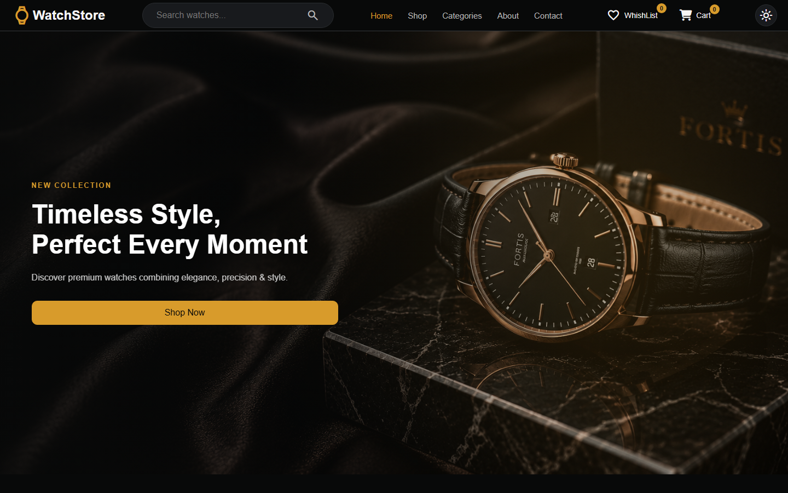
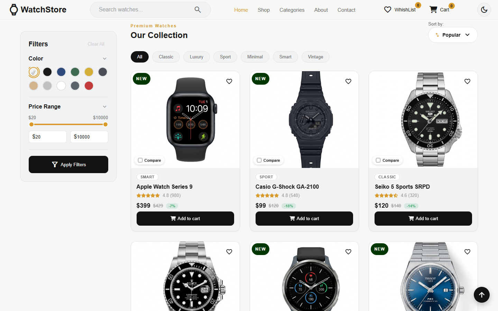
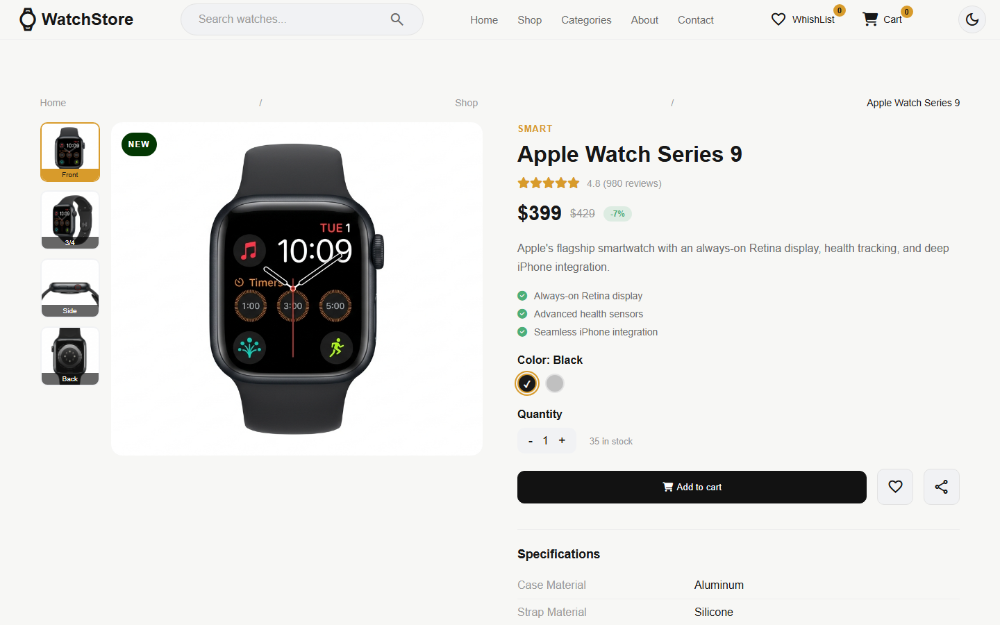
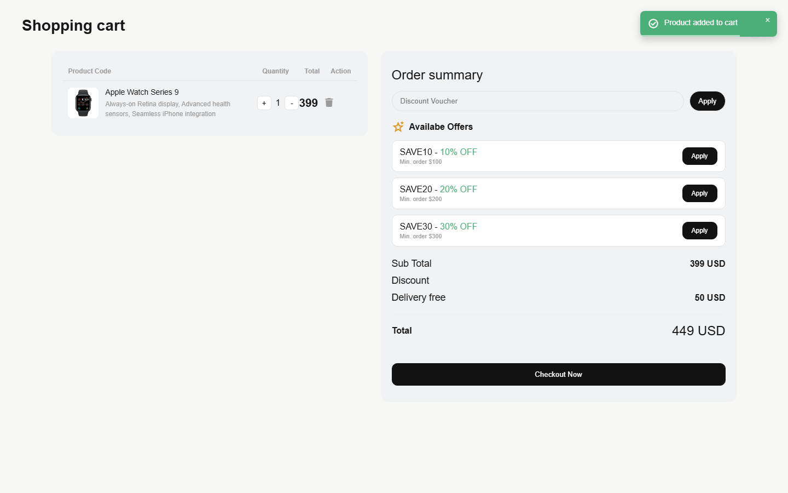
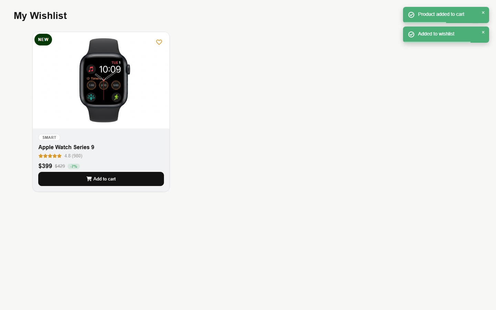
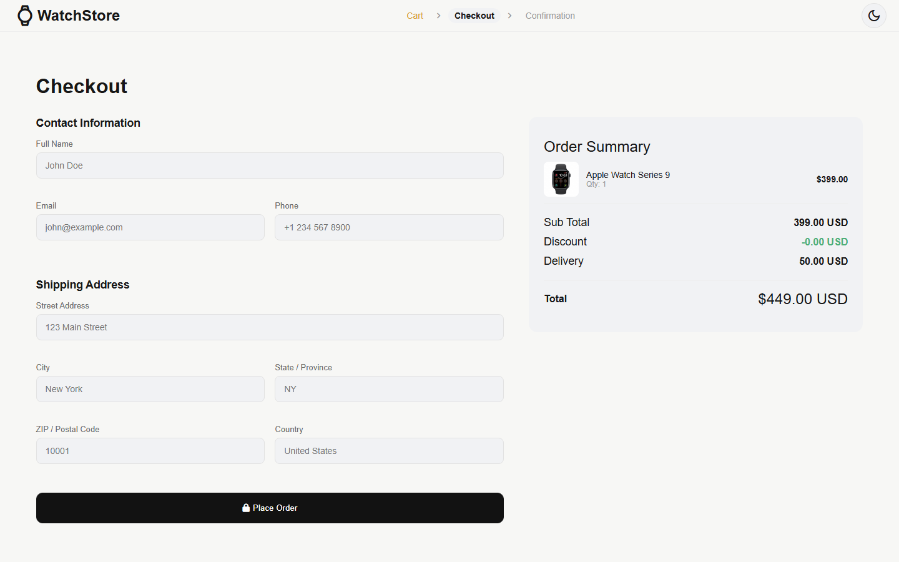
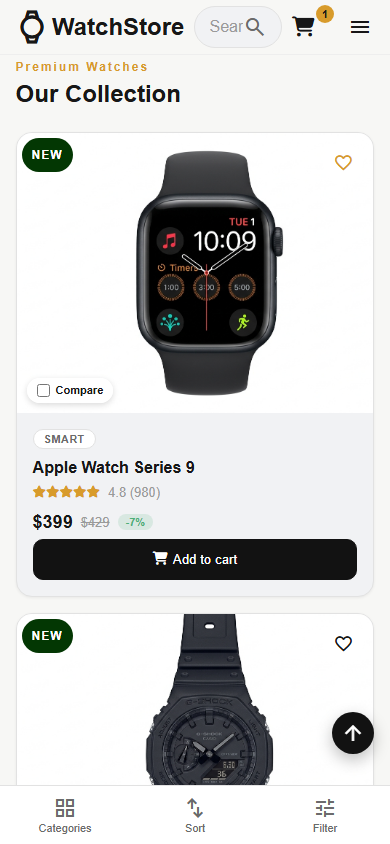

# WatchStore

A full-featured e-commerce demo for an online watch store, built with plain HTML, CSS, and JavaScript — no frameworks, no build step. It covers the full shopping flow: browsing and filtering a catalog, product details, cart and wishlist management, coupons, checkout, and order confirmation.

## Demo


*Browsing the catalog, filtering by category, viewing a product, adding it to the cart, applying a coupon, wishlisting an item, and completing checkout.*

## Project Description

WatchStore is a client-side watch shop built to practice and demonstrate real-world front-end e-commerce patterns without relying on a framework. Product, coupon, and review data is served from a small REST API (`json-server` locally, or serverless functions on Vercel in production), while cart, wishlist, compare list, recently-viewed items, theme preference, and applied coupon all persist in the browser via `localStorage` — so the shopping session survives a page reload.

The project is split across four pages that share the same design system and dark/light theme:

- **Shop** (`index.html`) — hero, category showcase, product grid, and the full filter/search/sort toolbar
- **Product Details** (`product-details.html`) — image gallery, specifications, related products, recently viewed, and customer reviews
- **Checkout** (`checkout.html`) — order summary, coupon carry-over, and a validated shipping/contact form
- **Order Confirmation** (`order-confirmation.html`) — a receipt-style summary of the placed order

## Features

- **Product catalog** — grid layout with pagination, skeleton loading states, and a graceful empty/error state if the API is unreachable
- **Search** — live search-as-you-type with a suggestions dropdown, matching across name, brand, category, color, and description
- **Filtering** — by category, color, and price range (dual-handle slider), with an active-filter count badge and a one-click "Clear filters"
- **Sorting** — by popularity, price (low/high), rating, and newest
- **Product details** — multi-angle image gallery, color/quantity selection, specifications table, native share (with clipboard fallback), and a review system (star rating + comments)
- **Related & recently viewed products** — related items from the same category, and a locally-tracked recently-viewed carousel
- **Product comparison** — queue up to 3 products and compare specs side-by-side in a modal
- **Cart** — add/remove items, quantity +/- controls, duplicate-prevention (merges quantity instead of duplicating rows), per-item and cart-wide subtotal calculation, and a live item count badge in the navbar
- **Wishlist** — heart-toggle from any product card, with its own dedicated panel
- **Coupons** — apply/remove discount codes with minimum-order eligibility that recalculates live as the cart total changes, and carries over into checkout
- **Checkout** — field-level form validation (name, email, phone, address, ZIP) and an order summary that mirrors the cart
- **Order confirmation** — a persisted receipt view with order ID, items, totals, and shipping address
- **Dark / light theme** — toggle persisted across sessions and pages
- **Fully responsive** — dedicated layouts for desktop, tablet, and mobile, including an off-canvas filter drawer and bottom toolbar on small screens
- **Toast notifications** — for cart/wishlist actions, coupon results, and form feedback, with de-duplication so repeated actions don't stack the same message

## Technologies Used

- **HTML5 / CSS3** — semantic markup, CSS custom properties for theming, CSS Grid & Flexbox for layout
- **Vanilla JavaScript (ES6+)** — no frameworks or build tooling; `fetch`, `localStorage`, and the DOM APIs directly
- **[json-server](https://github.com/typicode/json-server)** — mock REST API (`db.json`) for products, coupons, reviews, and orders during local development
- **Vercel Serverless Functions** — the same API surface reimplemented under `api/` for the production deployment
- **[Font Awesome](https://fontawesome.com/)** — iconography (cart, social, form icons)
- **[Material Symbols](https://fonts.google.com/icons)** — outlined icon set used throughout the UI
- **[http-server](https://www.npmjs.com/package/http-server)** — static file server for local development

## Screenshots

| | |
|---|---|
| **Home** | **Shop — Product Grid** |
|  |  |
| **Product Details** | **Cart** |
|  |  |
| **Wishlist** | **Checkout** |
|  |  |
| **Mobile** | |
|  | |

## Getting Started

```bash
# terminal 1 — mock API (json-server, reading db.json) on :3000
npm run start:api

# terminal 2 — static file server on :8080
npm run start:web
```

Then open `http://localhost:8080/index.html`.

## Deployment

The site is set up to deploy on Vercel as-is: static pages are served directly, and the `api/` folder provides serverless equivalents of the local `json-server` endpoints, so no separate backend needs to be hosted.
